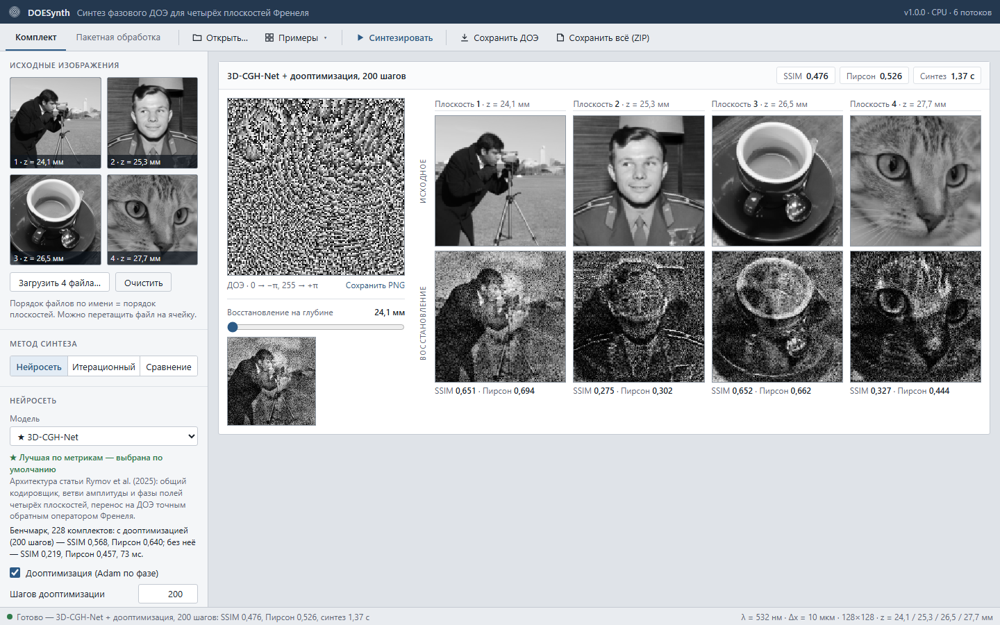

# DOESynth — нейросетевой синтез фазового ДОЭ

Решение команды **Loss Alamos** для хакатона **Nuclear IT Hack**.

Приложение строит один фазовый дифракционный оптический элемент (ДОЭ) по четырём изображениям
128×128. Каждое изображение восстанавливается в своей плоскости дифракции Френеля:
z = 24,1 / 25,3 / 26,5 / 27,7 мм, λ = 532 нм, пиксел ПВМС 10 мкм. ДОЭ сохраняется в PNG
128×128, 8 бит, оттенки серого: 0 → −π, 255 → +π.



## Запуск

Нужен только Docker (на Windows и macOS — Docker Desktop). Больше ничего ставить не нужно.

| Система | Запуск | Остановка |
| --- | --- | --- |
| Windows | дважды щёлкнуть `start.bat` | `stop.bat` |
| Linux, macOS | `sh start.sh` | `sh stop.sh` |

Скрипт запустит Docker, соберёт и запустит контейнер и откроет DOESynth отдельным окном —
в режиме приложения Edge или Chrome, без адресной строки и вкладок. Если ни одного из них
нет, откроется обычный браузер. Первая сборка занимает 5–10 минут (скачивается PyTorch, образ
≈ 3 ГБ), следующие запуски — секунды. Окно можно закрыть и снова открыть тем же скриптом;
контейнер работает до `stop`. Интерфейс доступен и по адресу **http://localhost:8000** в
любом браузере.

Вручную:

```bash
docker compose up -d --build        # затем открыть http://localhost:8000
```

или без compose:

```bash
docker build -t doesynth .
docker run --rm -p 8000:8000 doesynth
```

Если порт 8000 занят, задайте другой: `DOE_PORT=8080 sh start.sh`
(в Windows: `set DOE_PORT=8080` и затем `start.bat`).

## Интерфейс

1. **Исходные изображения.** Кнопка «Открыть…» (выбрать 4 файла), перетаскивание файла на
   ячейку или меню «Примеры». Порядок файлов по имени задаёт номер плоскости. Файлы не по
   условию (RGB, другой размер, 16 бит) приводятся к 8-битному серому 128×128 с предупреждением.
2. **Метод синтеза.**
   - «Нейросеть»: выбор модели (★ — лучшая по метрикам, выбрана по умолчанию) и галочка
     «Дооптимизация» (включена по умолчанию) с числом шагов.
   - «Итерационный»: Герчберг–Сэкстон (многоплоскостной или последовательный) или градиентный
     спуск Adam по фазе, с числом итераций.
   - «Сравнение»: оба метода на одних изображениях и таблица качества и времени.
3. **Синтезировать** (Ctrl+Enter). Результат: ДОЭ, исходные и восстановленные изображения
   по плоскостям, SSIM и коэффициент Пирсона для каждой плоскости, средние значения и время
   синтеза. Ползунок «Восстановление на глубине» показывает изображение на любом z.
4. **Сохранить ДОЭ** — PNG для сдачи. **Сохранить всё (ZIP)** — ДОЭ, 4 восстановления
   (PNG, 8 бит), исходные изображения, `metrics.json` и `summary.csv`.
5. **Пакетная обработка** (вкладка вверху). Выберите папку, в которой каждая подпапка —
   комплект из 4 изображений, или ZIP с такими папками. Каждый комплект обрабатывается
   выбранным методом. Результат — таблица SSIM, Пирсона и времени по комплектам со средним
   и ZIP со всеми файлами.

## Метод и лучшая модель

Синтез идёт в два шага. Нейросеть за ≈ 0,07 с строит начальную фазу ДОЭ. Затем
**двухэтапная дооптимизация** доводит фазу за 200 шагов Adam, ≈ 1 с на CPU.

Что сделано в решении:

- **Двухэтапная дооптимизация под SSIM условия** — основной источник качества. SSIM
  нормирует восстановление на максимум, поэтому яркие пики спекла делают изображение тёмным
  и сильно снижают SSIM. Первая половина шагов оптимизирует коэффициент Пирсона, вторая —
  Пирсона и SSIM вместе. Градиент максимума проходит через p-норму. По сравнению с
  дооптимизацией по одному Пирсону SSIM растёт на 0,13 при том же Пирсоне.
- **17 сетей, перенесённых и обученных в постановке задачи.** Это U-Net, развёрнутый
  Герчберг–Сэкстон, обученная суперпозиция, 3D-CGH-Net и её варианты с нашими доработками,
  а также сети других участников команды. Все обучены без учителя через формулу Френеля
  условия, эталонные фазы не нужны.
- **Выбор по заранее записанному правилу.** Модель и число шагов выбраны на отдельной
  выборке настройки по правилу, записанному до расчёта. Числа ниже получены на других
  228 комплектах: фото и документы, 6 категорий, которых не было в обучении, сечения
  3D-объектов. Протокол — в [benchmark/README.md](benchmark/README.md).

**Лучшая модель — 3D-CGH-Net с дооптимизацией 200 шагов.** Она выбрана по умолчанию и отмечена
★ в интерфейсе. Архитектура сети — из статьи D. A. Rymov et al. (НИЯУ МИФИ), «3D-CGH-Net:
Customizable 3D-hologram generation via deep learning», Optics and Lasers in Engineering 184
(2025) 108645, [doi:10.1016/j.optlaseng.2024.108645](https://doi.org/10.1016/j.optlaseng.2024.108645).
Мы перенесли её в постановку задачи (4 плоскости вместо 16, 128×128, формула Френеля условия) и
обучили заново. Выбранный вариант (R08-paper) — без наших изменений архитектуры. Ближайшие
варианты отстают меньше чем на 0,001 SSIM.

| Метод | SSIM | Пирсон | Время синтеза, CPU |
| --- | --- | --- | --- |
| **3D-CGH-Net + дооптимизация, 200 шагов (по умолчанию)** | **0,568** | **0,640** | 1,0 с |
| 3D-CGH-Net + дооптимизация, 100 шагов | 0,559 | 0,634 | 0,55 с |
| 3D-CGH-Net + 8 шагов спуска, без дооптимизации | 0,355 | 0,554 | 0,10 с |
| Adam со старта суперпозиции, та же дооптимизация, 200 шагов | 0,562 | 0,631 | 0,95 с |
| Герчберг–Сэкстон многоплоскостной, 200 итераций | 0,289 | 0,459 | 0,48 с |

Время замерено в контейнере на CPU ноутбука (6 потоков, Ryzen 5 5500U). Сеть даёт хороший
старт: при равном числе шагов старт из сети лучше старта из суперпозиции (+0,006 SSIM при
200 шагах). Качество Adam-1000 (SSIM 0,572, 4,7 с) сеть с дооптимизацией набирает за
300 шагов (1,5 с). После дооптимизации все 17 сетей отличаются меньше чем на 0,008 SSIM.
Полные таблицы по всем моделям — в [benchmark/summary.md](benchmark/summary.md).

## Командная строка

Тот же контейнер обрабатывает комплекты без интерфейса. Положите комплекты в `data/input/`
(подпапка = 4 изображения):

```bash
docker compose run --rm doe batch /data/input /data/output
```

В `data/output/<комплект>/` появятся `doe.png`, `recon_1..4.png` и `metrics.json`, а в
`data/output/summary.csv` — SSIM, Пирсон и время по комплектам и среднее. Другие команды:

```bash
docker compose run --rm doe synth /data/a.png /data/b.png /data/c.png /data/d.png --out /data/result
docker compose run --rm doe info       # список моделей и методов
docker compose run --rm doe selftest   # самопроверка: метрики, формат ДОЭ, физика, синтез
```

Параметры `batch` и `synth`: `--model <id>`, `--steps N`, `--no-finetune`,
`--mode net|iter|compare`, `--method gs|gs_seq|adam`, `--iters N`.

## Как это устроено

- **Физика** — формула Френеля с одним БПФ из условия. Восстановленное изображение —
  интенсивность |K|², переведённая в 8 бит линейно (максимум → 255). Метрики считаются по
  ДОЭ, уже квантованному в 8 бит.
- **Метрики.** SSIM — по формуле условия (одно окно на всё изображение,
  c₁ = (0,01·255)², c₂ = (0,03·255)²). Пирсон — по всему изображению. Обе метрики считаются
  для каждой из 4 пар «исходное ↔ восстановленное» и усредняются. Оконный SSIM записывается
  в `metrics.json` справочно.
- **Сети** обучены без учителя: генератор изображений → сеть → фаза ДОЭ → дифференцируемый
  расчёт Френеля → 1 − Пирсон по четырём плоскостям. Эталонные фазовые маски не нужны.
- **Дооптимизация** — N шагов Adam по фазе, старт — фаза сети. Первая половина шагов —
  1 − Пирсон, lr 0,4. Вторая — 1 − Пирсон + (1 − SSIM условия), lr 0,05; градиент максимума
  считается через p-норму (p = 8), значение остаётся точным максимумом
  (`doesynth/methods.py`, `finetune`).
- **Время** — только синтез фазы (сеть + дооптимизация или итерации), после прогрева;
  в таблицах есть и полное время с восстановлением и метриками.

## Состав репозитория

| Путь | Что там |
| --- | --- |
| `doesynth/` | Приложение: `optics.py` — модель Френеля, `metrics.py` — SSIM и Пирсон, `methods.py` — GS, Adam и дооптимизация, `models/` — архитектуры сетей, `pipeline.py` — сценарий синтеза, `server.py` и `static/` — интерфейс, `__main__.py` — командная строка. |
| `weights/` | Обученные веса сетей. |
| `training/` | Исходный код обучения и конфиги всех поставляемых сетей (см. `training/train.py`). |
| `benchmark/` | Наборы, скрипты и результаты сравнения, по которым выбраны модель и параметры по умолчанию (`summary.md`). |
| `examples/` | 9 комплектов для проверки. Фото Ю. А. Гагарина — Arto Jousi, 1961, общественное достояние ([Wikimedia Commons](https://commons.wikimedia.org/wiki/File:Yuri_Gagarin_(1961)_-_Restoration.jpg)); остальные фото — из scikit-image. |
| `Dockerfile`, `docker-compose.yml`, `requirements.txt` | Сборка и зависимости. |
| `start.bat`, `start.sh`, `stop.*` | Запуск одним щелчком. |

Обучение (нужен GPU с CUDA):

```bash
cd training
pip install -r requirements.txt
python train.py configs/R08-paper.yaml
```

Конфиги R02, R03, R06, R12 и R13 берут фото из COCO val2017: положите их в
`training/data/coco2017/val2017` или укажите свой путь в `photos_dir`.
